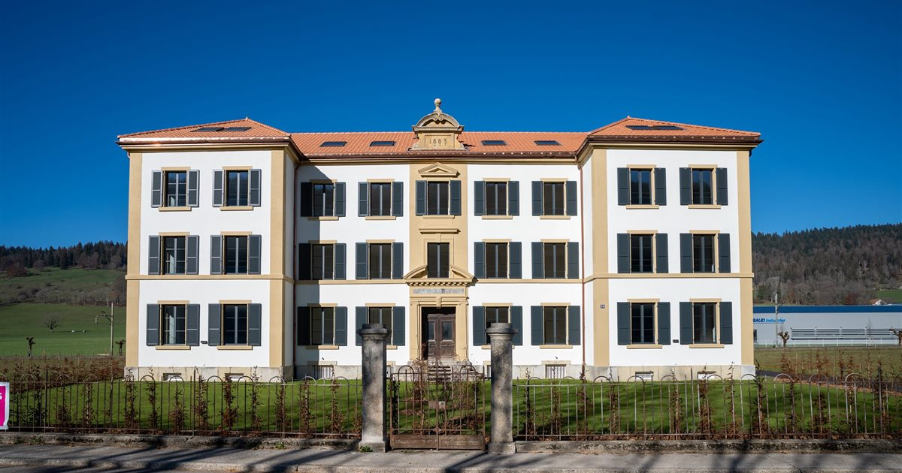

# Sully-Lambelet: sales website for a historic building conversion

**Website:** [ppesullylambelet.ch](https://ppesullylambelet.ch/) · Personal project · Luca Rota

> This repository is a showcase. The source code, floor plans and photo material are not public. Only this description is published. The live website is the best way to see the result.

## What is it about?

Sully-Lambelet is a historic building from 1883 in Les Verrières (NE), Switzerland, converted into seven apartments in condominium ownership (PPE). I designed and built the website that presents the project and the apartments to prospective buyers.

## Goal

A fast, clean and mobile-friendly site that lets a visitor understand the building, pick an apartment, look at its plan and photos, and get in touch, without any account, backend or heavy framework.

## Features

- **Apartment selector:** the seven lots with type, floor, orientation, surfaces and status, presented interactively.
- **Floor plans:** viewable directly in the page, with zoom and touch gestures.
- **Photo tours:** swipe and double-tap navigation through the photos of each apartment, and an exterior gallery with fast loading of the first pictures.
- **Story and location:** the history of the building and an interactive map of the area.
- **Search and sharing:** structured data, sitemap, robots rules and a share image so that the site is well referenced and looks good when a link is shared.

## Technical choices

| Topic | Choice |
|---|---|
| Stack | Static site: HTML, CSS and vanilla JavaScript, no framework and no build step |
| Plans | PDF rendering in the browser with pdf.js |
| Map | Leaflet |
| Images | Web-optimised versions only (reduced size and weight), originals kept offline |
| Hosting | GitHub Pages with a custom domain |
| Statistics | Cloudflare Web Analytics, cookie-free |

## Contact

For any further information about this project, feel free to contact me by e-mail: **lu.rota@sunrise.ch**
